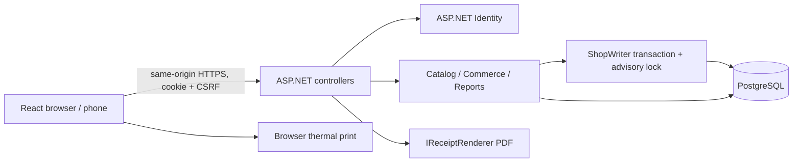

# Architecture and decisions

MiniShop is a modular monolith: one deployable ASP.NET process serves a React application and REST APIs, backed by PostgreSQL. There is one authentication authority and one transactional database. This is easier to operate on a shop PC than multiple services and makes inventory and credit updates atomic.

During development Vite proxies `/api` to port 5080. For local deployment `Build.ps1` copies the built frontend into the API's `wwwroot`, so a single origin handles browser cookies and API requests. No permissive CORS policy is needed. Production uses HTTPS; HTTP is allowed in Development for localhost only.

## Checkout flow

1. React rounds preview line totals using decimal.js, captures a UUID and exact checkout payload, and stores that pending intent in session storage before sending it. Products/prices in the browser are advisory previews.
2. The authentication cookie identifies the cashier. Authorization and antiforgery validation run before the controller. Data annotations check DTO shapes.
3. `CommerceService` begins a PostgreSQL transaction through `ShopWriter`. A transaction-scoped advisory lock serializes short commerce writes across all API processes sharing this database.
4. A matching request key and matching actor/payload return the previous sale. Reuse with different content is a conflict. A unique database index is a second line of defense.
5. The service loads current active products and their batches, aggregates duplicate cart lines, validates units, and allocates unexpired stock by earliest expiry, then receiving time/id. An expiry equal to today is sellable through the end of that Philippine business date.
6. Server prices determine line totals, rounded away from zero to cents. Discount cannot exceed subtotal and requires an Owner. Cash is capped at the total; excess becomes change. Any remainder requires an active named customer and credit-limit check.
7. Sale/items/batch allocations, stock deductions/movements, payment, applied discount, credit charge, and audit entry are saved in one database transaction. Any error rolls everything back. The transaction lock releases on commit/rollback/disconnection.
8. The browser clears the pending key only after a confirmed result. On an unknown network/server outcome it keeps the exact request for retry. It never automatically retries a mutation with a new key.

The global lock trades high throughput for an easily reviewed invariant: no two shop writers can read and spend the same available stock or credit allowance concurrently. The stock check constraint still rejects negative quantities. A report/read need not acquire the writer lock; aggregate report queries may see adjacent committed states under concurrent activity, so run official reconciliation while the counter is quiet or add a repeatable-read reporting snapshot in a future release.

## Credit and reversals

Balance is `SUM(CreditTransactions.Amount)`, not a customer field that can be overwritten. A sale creates a positive charge. A repayment creates one positive collection payment and negative credit entries allocated to the oldest unsettled sales. Full refund creates a negative entry only for that sale's remaining debt. The cash refund equals sale total less its remaining debt, so previously repaid credit is returned as cash. Repeating a refund has no second effect.

Stock allocations preserve which batch and cost each sale consumed. Refunds restore those allocations, retain the original sale, set its refund status/date/reason, and append compensating records. Database triggers prevent UPDATE/DELETE on credit, stock-movement, and audit history. Application roles should also lack unnecessary table privileges; a database administrator can still bypass controls and must be trusted.

## Identity, requests, and deployment

Identity manages salted password hashes, roles, lockout, and security stamps. Sessions use HttpOnly, Strict SameSite cookies, last at most eight hours, and are checked against active status and security stamps on every request. Mutations require `X-CSRF-TOKEN`, including login/logout. The frontend fetches a fresh token before login and after identity changes. Login has an IP-based rate limit and a per-account lockout. There is no open registration endpoint.

Receipt rendering is behind `IReceiptRenderer`; a future printer adapter can implement a separate spooler interface using the immutable sale receipt model. Keep direct device I/O outside the database transaction, and record print jobs separately so printer failure never replays checkout.

Cloud access should initially centralize the same application behind HTTPS and secure administration. Any later offline-to-cloud replication needs an outbox, global ids, per-store ownership, a conflict policy, immutable accounting events, reconciliation, and durable idempotency. A stale cloud stock copy must never authorize a local sale. See DEPLOYMENT_GUIDE.

References used for implementation: [EF Core transactions](https://learn.microsoft.com/en-us/ef/core/saving/transactions), [concurrency](https://learn.microsoft.com/en-us/ef/core/saving/concurrency), [ASP.NET Identity](https://learn.microsoft.com/en-us/aspnet/core/security/authentication/identity?view=aspnetcore-10.0), and [Npgsql EF Core 10](https://www.npgsql.org/efcore/release-notes/10.0.html).
